<div align="center">



[简体中文](README.md) · **English**

[](#)
[](#)
[](#)
[](#)
[](LICENSE)

[Quick start](#quick-start) · [Security model](#security-model) · [Threat model & known limitations](#threat-model--known-limitations) · [FAQ](#faq) · [Architecture details](docs/ARCHITECTURE.en.md)

</div>

---

> **Risk notice**: This project drives a third-party website (the DeepSeek web app) via the browser automation protocol (CDP) and reads its internal endpoints. This **may violate the service's terms of use and could put your account at risk of restriction**. Evaluate compliance yourself, at your own risk; intended for personal study and research only. Not affiliated with DeepSeek or any model provider.

## What is this

Mica is a Windows desktop AI agent that **does not call any model API**. Instead, it embeds **the DeepSeek web app you are already logged into** as its inference engine (Tauri WebView2), while a local Rust engine reads the model's replies at the network layer via CDP and drives complete multi-turn tool-calling loops.

- **Zero API cost** — reuses your web session; no key, no per-token billing (subject to the web app's own quotas and rate limits)
- **Data stays local** — conversations, tool results and the audit trail never leave your machine; no telemetry
- **Network-layer readback** — results are taken from the model's SSE reply stream, not from fragile page DOM internals
- **Fail-closed approval gate** — non-read-only commands are blocked by default, executed only after explicit per-command approval, all audited

Full architecture and implementation notes: **[docs/ARCHITECTURE.en.md](docs/ARCHITECTURE.en.md)** ([简体中文](docs/ARCHITECTURE.md)).

## Quick start

**Requirements**: Windows 10+ (with WebView2 Runtime; built into Win11) · Rust 1.99 · Node 18+ · VS Build Tools 2022 (VC + Windows SDK). Python 3 is only needed for the quality-gate tools.

```powershell
git clone https://github.com/questin2/mica.git
cd mica/app

npm install
npm run build                # frontend bundle -> dist/

cd src-tauri
cargo build                  # produces target\debug\eagent-app.exe
```

Run (either):

```powershell
# Option A: dev mode (frontend hot reload)
cd mica\app
npm run tauri dev

# Option B: run the built binary
.\app\src-tauri\target\debug\eagent-app.exe
```

**First run**: sign in to your DeepSeek web account inside the embedded WebView → set a working directory in the left rail → click "inject prompt" to initialize the session. Then just chat and hand it tasks that need local tools.

Quality gates (optional, recommended after code changes):

```powershell
# from the repo root; -ExecutionPolicy Bypass is only for running the repo's own test scripts
powershell -NoProfile -ExecutionPolicy Bypass -File tests\run_tests.ps1
python tools\verify_assets.py --all
cd app\src-tauri && cargo test
cd app && npm test
```

> Note: the project was renamed from EAgent. Some code-level identifiers (the `eagent-app.exe` binary name, data directories, the `EAGENT_*` env-var prefix) still use the historical name and will be migrated in a later release.

## Security model

Design principles: **default-deny, a single approval entry point, and an audit trail for every execution**.

- **Approval gate** — every execution path converges into one gate; the approval card shows the **fully substituted command**, so what you approve is exactly what runs
- **Risk classification** — pipes / semicolons / redirections / script blocks / write cmdlets are classified as dangerous; the danger class gets **no** "allow all" option
- **Audit trail** — every command's hash, risk class and approval source (human / automatic) is written to a local audit log, viewable in the app
- **Config protection** — security-related config (approval rules, MCP list, …) is frozen as a startup snapshot; external file edits require explicit confirmation in Settings, otherwise safe defaults apply
- **Secret isolation** — secrets live in the user data directory (historical name `%APPDATA%\EAgent\secrets`), never in the repo

## Threat model & known limitations

What it **does and does not protect against** — for a tool that executes local commands, this matters more than promises of absolute safety:

**What it defends against**:
- Dangerous commands hallucinated or mis-derived by the model being executed outright (default-deny + per-command human approval)
- "Allow all" shortcuts being extended to dangerous operations (the danger class offers no such option)
- Silent tampering with security config (snapshot + explicit confirmation)
- "Something ran but nobody knows what" (full audit log)

**What it does not defend against (known limitations)**:
- **Risk classification is text-pattern matching on the command**, and can be bypassed: PowerShell aliases, encoded commands, or obfuscated one-liners may be misjudged as low-risk. **The final line of defense is you actually reading the full command on the approval card** — treat it as a real confirmation step, not a formality
- **Prompt injection from web content**: pages the model reads may contain content that goads it into generating dangerous commands. Such commands still pass through the approval gate, but if you approve without reading, the defense fails at your layer
- **Auto-approval** (optional, off by default): once enabled, commands within its rules run without confirmation — enabling it means accepting that trade-off; the UI shows a persistent red warning badge
- The approval gate is a **single convergence point by design**, not a formal security proof; for strong guarantees, run the app inside an isolated environment (VM / sandbox)

## FAQ

**Q: Can it execute commands without my knowledge?**
By design, no. All non-read-only commands require individual approval by default. The only auto-execution surface (`autoApprovePatterns`) is empty by default and fully inert; when enabled, the UI shows a persistent red warning badge, danger-class commands never enter auto-approval, and every grant is logged and revocable in one click. Still, read the [threat model](#threat-model--known-limitations) to understand the limitations.

**Q: Why zero cost? Is it using my own account?**
Yes. Mica drives **your own logged-in** DeepSeek web session, not an API — no key, no token billing. The trade-offs: the web app's usage limits apply, plus the ToS risk described above.

**Q: Which models are supported?**
Two built-in channels: the **DeepSeek web app** (default, adapted and tested) and **local Ollama models**. This is not "any web model works out of the box" — supporting another site requires adapting its selectors and endpoints, which is extension work.

**Q: Where does my data live?**
Everything is local: sessions and config in the workspace data directory, the audit log in the app data directory (`app/data/audit.log`, excluded from git tracking), secrets in `%APPDATA%\EAgent\secrets`. No telemetry.

**Q: Why Windows only?**
The engine depends on WebView2 and the PowerShell toolchain — a deliberate scope decision, not a technical limitation. Cross-platform support is being evaluated for the 2.0 plan.

## Roadmap

- [x] Embedded WebView2 spike (CDP direct / file upload / screenshots / login persistence / full round-trip)
- [x] Agent main loop + fail-closed approval gate + audit closure
- [x] Network-layer interception engine (replacing DOM guessing)
- [x] Skills / plugins / session persistence / fully externalized config
- [x] Release hardening: path fallback / crash dumps / single instance
- [ ] MCP bridge, full rollout (**in progress**)
- [ ] Engine rewrite wrap-up & brand unification (remove the CDP channel, migrate legacy identifiers)

## Documentation

| Document | Contents |
|---|---|
| [docs/ARCHITECTURE.en.md](docs/ARCHITECTURE.en.md) | Architecture & implementation details (how it works / modules / configuration / quality gates) |
| [docs/ARCHITECTURE.md](docs/ARCHITECTURE.md) | 架构与技术实现详情（简体中文） |

## License

[MIT](LICENSE) © 2026 questin2

---

<div align="center">

<sub>Rust · Tauri · 0 tokens spent</sub>

</div>
