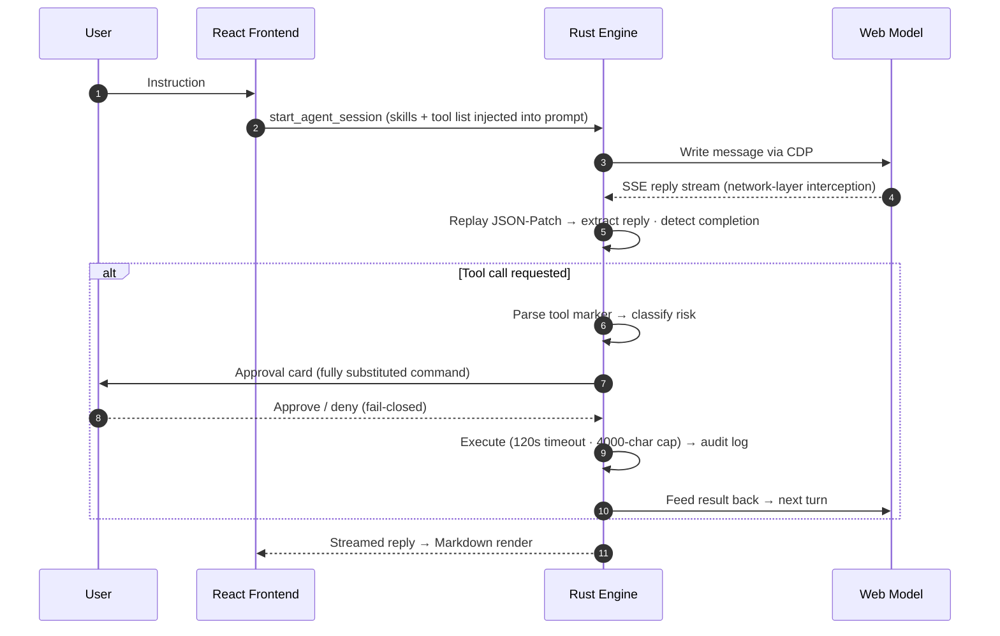
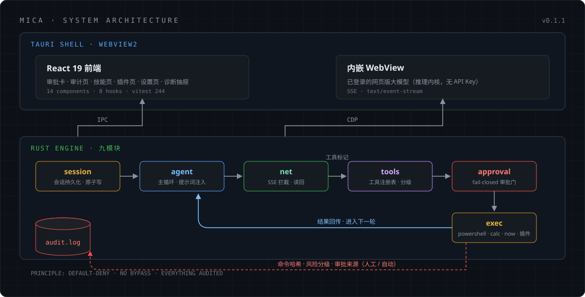

# Mica — Architecture & Implementation Details

> Technical companion to [README.en.md](../README.en.md): how it works, engine modules, feature implementation, configuration reference, and quality gates.
> Terminology: the **reference implementation** refers to the previous-generation prototype (written in 易语言/EPL). It served only as a capability checklist and the basis for security remediation — it is not an upstream dependency of this project.

## How it works

### Network-layer readback (the core technical decision)

Earlier prototypes decided "has the model finished replying" by matching CSS class names / SVG icons on the page — fragile and unreliable. The current engine operates directly on CDP network events and depends on no frontend implementation details:

1. **Endpoint confirmation**: the web model's replies arrive via its chat-completion endpoint as `text/event-stream` (not WebSocket; plain text, no protobuf reversing needed)
2. **Completion detection**: primary signal = `Network.loadingFinished`; readback = `Network.getResponseBody`
3. **Patch replay**: the response body is a JSON-Patch stream; replay it and keep only `RESPONSE` segments (excluding thinking segments), stitching the final reply in order
4. **Fallback path**: DOM reading remains as a fallback, guarded by an **echo guard** — if the text read back starts with the prompt just injected (the model "echoing" the user input), it is discarded
5. **Explicit failure**: when both paths return nothing, the engine fails loudly instead of silently returning an empty string (the empty-reply bug was fixed at the protocol level)

Verified on live sessions (`baseline/chain_test_run1.log`): a full round-trip read back `reply="OK"` in 4 seconds; multi-turn sessions read back 673–920 characters of correct replies.

### One full tool-calling round

## Architecture overview

### Rust engine modules (20 modules; figures as of 2026-10)

| Module | Responsibility | Implementation notes |
|---|---|---|
| `agent` | Agent main loop | Prompt assembly, tool-iteration guardrail (`maxToolIterations`, default 30) |
| `net` | Network-layer readback | SSE interception, JSON-Patch replay, echo guard, explicit errors |
| `tools` | Tool registry | Unified registration of built-in + plugin tools; prompt annotations appended on demand |
| `builtin` | Built-in tools | `now` / `calc` (hand-written recursive-descent parser, no `eval`) |
| `mcp_bridge` | MCP bridge (**in progress**) | Supply-chain allowlist, environment allowlist, pinned package versions |
| `config` | Configuration center | Runtime-first with embedded fallback; security config frozen as startup snapshot |
| `approval` / `security` | Approval & risk classification | Execution paths converge to a single gate; danger checks run first; sensitive-path backstop |
| `exec` | Command execution | Hidden window, 120s timeout, 4000-character output cap |
| `session` / `store` | Session & persistence | Atomic writes (tmp→rename), pre-write backup, read fallback, pre-write validation |
| `plugins` | Plugin system | Per-plugin fault isolation, path-traversal blocking, two-gate delete protection |
| `skills` | Skill library | Data-driven, `{{SKILLS}}` prompt placeholder, built-in skills auto-seeded |
| `cdp` / `browser` | CDP channel | Random port, isolated profile, **no** `--remote-allow-origins=*` (experimentally verified unnecessary) |
| `workflows` | Workflows | Multi-step task orchestration |
| `commands` / `state` / `log` | IPC / state / logging | Tauri command layer, global state, structured logging |

### Frontend structure

React 19 + Vite: 19 display/page components (ApprovalCard / AuditPage / PluginsPage / SkillsPage / McpPage / WorkflowPage / MessageList / …) plus 8 hooks (useEngineEvents / useSessionPersistence / useBrowserRect / …). Tests focus on the `classify` risk classifier and the XSS attack surface of Markdown rendering.

## Feature implementation notes

**Agent loop**
Prompt injection (skills + tool list) → model generation → tool-marker parsing (the PowerShell code-block protocol and the generic JSON protocol `{"name":…,"arguments":{…}}` run in parallel) → risk classification → approval → execution → result readback → next turn. Tool calls per turn, per-command timeout and output cap are all configurable, guarding against runaway loops and output explosions. Malformed JSON / unknown tool names return explicit errors — never silent guessing.

**Tools**
- `powershell`: hidden-window execution, 120s timeout, 4000-character output truncation
- `now` / `calc`: hand-written recursive-descent parser, no `eval`; pure computation skips approval, everything else goes through the gate
- Plugin tools: command templates with `{{arg}}`; with no plugin tools installed the appended prompt annotation is exactly 0 characters — byte-for-byte identical to the plugin-less protocol (verified both directions on live sessions)
- `extendedTools` safety valve: set to `false` to fall back to the PowerShell-only protocol, no recompile needed

**Skill system**
Skills are data-driven (`<data_dir>/skills.json`): add / delete / restore built-ins, categories derived from data. At session init, skills are written to `<tmp>/skills.md` and injected into the prompt via the `{{SKILLS}}` placeholder, so the model can actually see the skill list.

**Plugin system**
Scans `<data_dir>/plugins/<dir>/plugin.json`; plugins contribute skills and tools. Parsed one by one — a broken plugin fails alone without dragging others down; same-name conflicts resolve to the local copy; plugin skills are read-only; directory-name conversion blocks path traversal; deletion requires both "direct child of the plugin root" and "contains plugin.json".

**Session persistence**
`<data_dir>/session.json`: atomic writes (tmp→rename), pre-write `.bak` backup, read fallback (corrupt main file falls back to backup), pre-write validation (rejects invalid JSON). The frontend debounces writes by 800ms; on restart the message stream, decided tool calls and working directory are fully restored.

**Externalized config**
Config previously baked in at compile time via `include_str!` is now runtime-first with embedded fallback — config changes without recompiling. Startup logs report config sources and effective parameters.

## Configuration reference

| File | Purpose | Takes effect |
|---|---|---|
| `config/agent.json` | Engine behavior: `toolTimeoutSec`(120) · `toolOutputCap`(4000) · `maxToolIterations`(30) · `extendedTools` · `autoApprovePatterns` | Non-security fields next turn; security fields are snapshot-tier |
| `config/approval.json` | Risk classification rules: `danger[]` + `readonly[]` (as of 2026-10: 16 + 94 entries) | Security snapshot, effective after Settings confirmation |
| `config/mcp.json` | MCP server list (default: `fs` only, root locked to workspace) | Security snapshot |
| `config/provider.json` | Model providers (DeepSeek web CDP / Ollama); contains no account credentials | Security snapshot |
| `config/selectors.json` | DOM fallback selectors (v1) | Runtime |
| `config/prompt.initial.md` | Human-readable system prompt (with `{{SKILLS}}` placeholder) | Runtime |

Missing or invalid config always falls back to in-code defaults — the design goal is that corrupted config can never weaken the security boundary.

## Quality gates

| Gate | Contents |
|---|---|
| Static tests (`tests/run_tests.ps1`) | BOM / syntax / byte-consistency / config validity |
| Asset drift verification (`tools/verify_assets.py`) | Three-source verification of scripts vs binary constants |
| Rust tests | 143 cases (as of 2026-10) |
| Frontend tests (vitest) | 244 cases (as of 2026-10), focused on the risk classifier and XSS attack surface |
| Launch smoke (`tests/smoke_launch.ps1`) | Random port + isolated profile, self-starting and self-cleaning |

## Security remediation record

**Background**: the reference implementation (previous-generation prototype) had three security issues: running with administrator rights, `taskkill`ing all PowerShell processes before every tool call, and exposing CDP on fixed port 9222 with `--remote-allow-origins=*`.

**Mica's remediation**: normal privileges, no global kill, random port; a smoke experiment proved Chrome 155 requires no `--remote-allow-origins=*` for a new client (no Origin header). The end-state plan is to **remove the CDP channel entirely** in favor of a controlled model-access layer.

## Legacy naming note

The project was renamed from EAgent. The following code-level identifiers still use the historical name and are scheduled for migration:

- Binary name `eagent-app.exe` (`productName` in `tauri.conf.json`)
- The `EAgent` segment in user data / secrets paths (`%APPDATA%\EAgent\secrets`)
- The `EAGENT_*` env-var prefix used by sensitive-path detection
- Some documentation filenames (e.g. `16-eagent-2.0-plan-v1.1.md`)
