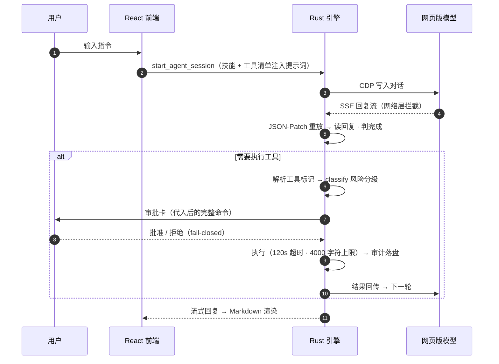

# Mica 架构与技术实现详情

> 本文是 [README.md](../README.md) 的技术展开：工作原理、引擎模块、功能实现、配置参考与质量门禁。
> 术语约定：**参考实现**指上一代原型（易语言编写），仅用于能力对照与安全整改的依据，不是本项目的上游依赖。

## 工作原理

### 网络层读回（核心技术决策）

早期原型靠比对页面 CSS 类名 / SVG 图标判断"模型是否回复完毕"——脆弱且不可靠。现行引擎直接在 CDP 网络事件层工作，不依赖任何前端实现细节：

1. **端点确认**：实测确认网页模型的回复走其聊天完成接口（`text/event-stream`，非 WebSocket，纯文本无需逆向 protobuf）
2. **完成判定**：主信号 = `Network.loadingFinished`；读回 = `Network.getResponseBody`
3. **补丁重放**：响应体是 JSON-Patch 补丁流，逐条重放后只取 `RESPONSE` 片段（排除思考片段），按序拼出最终回复
4. **兜底路径**：DOM 读取保留为兜底，加装**回声守卫**——读到的文本若与刚注入的提示词开头相同（把用户输入"读"了回来），判定为回声、丢弃
5. **显式失败**：两条路皆空时明确报错，不静默返回空串（空回复问题曾在协议层根治）

真机验证记录：完整回合 4 秒读回 `reply="OK"`；多轮会话读到 673–920 字符正确回复。

### 一次工具调用的完整回合

## 架构总览

### Rust 引擎模块（20 个；规模数据截至 2026-10）

| 模块 | 职责 | 关键实现点 |
|---|---|---|
| `agent` | Agent 主循环 | 提示词组装、工具轮次护栏（`maxToolIterations`，默认 30） |
| `net` | 网络层读回 | SSE 拦截、JSON-Patch 重放、回声守卫、显式报错 |
| `tools` | 工具注册表 | 内置 + 插件工具统一注册，提示词按需追加说明 |
| `builtin` | 内置工具 | `now` / `calc`（手写递归下降解析器，不 eval） |
| `mcp_bridge` | MCP 桥接（**开发中**） | 供应链白名单、环境白名单、包钉版本 |
| `config` | 配置中心 | 运行时优先 + 内嵌兜底；安全配置启动冻结快照 |
| `approval` / `security` | 审批与风险分级 | 执行路径收敛单一入口、危险判定固定最先、敏感路径兜底 |
| `exec` | 命令执行 | 隐藏窗口、120s 超时、4000 字符输出上限 |
| `session` / `store` | 会话与持久化 | 原子写（tmp→rename）、写前备份、读时回退、写前校验 |
| `plugins` | 插件系统 | 逐个故障隔离、路径穿越阻断、双闸删除保护 |
| `skills` | 技能库 | 数据驱动、注入 `{{SKILLS}}` 占位符、内置技能自动播种 |
| `cdp` / `browser` | CDP 通道 | 随机端口、独立 profile、无 `--remote-allow-origins=*`（实验验证可省） |
| `workflows` | 工作流 | 多步任务编排 |
| `commands` / `state` / `log` | IPC / 状态 / 日志 | Tauri 命令层、全局状态、结构化日志 |

### 前端结构

React 19 + Vite：19 个展示/页面组件（ApprovalCard / AuditPage / PluginsPage / SkillsPage / McpPage / WorkflowPage / MessageList 等）+ 8 个 Hook（useEngineEvents / useSessionPersistence / useBrowserRect 等），测试覆盖 `classify` 风险分级器与 Markdown 渲染的 XSS 攻击面。

## 功能实现要点

**Agent 循环**
提示词注入（技能 + 工具清单）→ 模型生成 → 工具标记解析（PowerShell 代码块协议与通用 JSON 协议 `{"name":…,"arguments":{…}}` 并行兼容）→ 风险分级 → 审批 → 执行 → 结果读回 → 下一轮。单轮工具次数、单命令超时与输出上限可配置，防死循环与输出爆炸。坏 JSON / 未知工具名明确回传错误，不静默猜测。

**工具**
- `powershell`：隐藏窗口执行，120s 超时，4000 字符输出截断
- `now` / `calc`：手写递归下降解析器，不使用 `eval`；纯计算不经审批，其余一律过审批门
- 插件工具：带 `{{arg}}` 的命令模板；无插件工具时附加说明为 0 字符，协议与无插件版逐字一致（真机双向实测）
- `extendedTools` 安全阀：设 `false` 回退到仅 PowerShell 协议，无需重编译

**技能系统**
技能数据驱动（`<data_dir>/skills.json`）：添加 / 删除 / 恢复内置，分类自动推导。会话初始化时写入 `<tmp>/skills.md` 并注入提示词 `{{SKILLS}}` 占位符，使模型能实际看到技能清单。

**插件系统**
扫描 `<data_dir>/plugins/<目录>/plugin.json`，插件可贡献技能与工具。逐个解析、坏插件单独报错不拖垮其他；同名以本地为准；插件技能只读；目录名转换阻断路径穿越；删除需同时满足"插件根目录直接子目录"与"含 plugin.json"两道闸。

**会话持久化**
`<data_dir>/session.json`：原子写（tmp→rename）、写前备份 `.bak`、读时回退（主文件损坏自动用备份）、写前校验（拒绝非法 JSON）。前端变更后 800ms 防抖落盘，重启恢复消息流、已决策工具与工作目录。

**配置外置**
原 `include_str!` 编译期固化的配置改为运行时优先 + 内嵌兜底，改配置免重编译。启动日志报告配置来源与生效参数。

## 配置参考

| 文件 | 用途 | 生效方式 |
|---|---|---|
| `config/agent.json` | 引擎行为：`toolTimeoutSec`(120) · `toolOutputCap`(4000) · `maxToolIterations`(30) · `extendedTools` · `autoApprovePatterns` | 非安全字段下一回合生效；安全字段属快照 |
| `config/approval.json` | 风险分级规则：`danger[]` + `readonly[]`（截至 2026-10：16 + 94 条） | 安全快照，设置页确认后生效 |
| `config/mcp.json` | MCP server 清单（默认仅 `fs`，根目录锁定 workspace） | 安全快照 |
| `config/provider.json` | 模型接入（DeepSeek 网页 CDP / Ollama），不含账号凭据 | 安全快照 |
| `config/selectors.json` | DOM 兜底路径选择器（v1） | 运行时生效 |
| `config/prompt.initial.md` | 系统提示词可读版（含 `{{SKILLS}}` 占位符） | 运行时生效 |

所有配置缺失或非法时自动回落代码内默认值——设计目标是配置损坏不削弱安全边界。

## 质量门禁

| 门禁 | 内容 |
|---|---|
| 静态测试（`tests/run_tests.ps1`） | BOM / 语法 / 字节一致性 / 配置有效性 |
| 资产漂移校验（`tools/verify_assets.py`） | 脚本与二进制内常量三源全验 |
| Rust 测试 | 143 例（截至 2026-10） |
| 前端测试（vitest） | 244 例（截至 2026-10），重点覆盖风险分级器与 XSS 攻击面 |
| 启动冒烟（`tests/smoke_launch.ps1`） | 随机端口 + 独立 profile 自开自关 |

## 安全整改记录

**背景**：参考实现（上一代原型）存在三项安全问题：以管理员权限运行、每轮工具调用前 `taskkill` 全部 PowerShell、CDP 固定 9222 端口且开启 `--remote-allow-origins=*`。

**Mica 的整改**：普通权限运行、无全局 kill、随机端口；冒烟实验证实 Chrome 155 上新客户端（无 Origin 头）无需 `--remote-allow-origins=*`（冒烟实验证实 Chrome 155 上新客户端无需 `--remote-allow-origins=*`）。终态计划**移除 CDP 通道**，改用受控的模型接入层。

## 历史命名说明

项目更名自 EAgent。以下代码级标识符仍为历史命名，计划统一迁移：

- 可执行文件名 `eagent-app.exe`（`tauri.conf.json` 的 productName）
- 用户数据目录与密钥路径中的 `EAgent` 段（`%APPDATA%\EAgent\secrets`）
- 敏感路径检测用的 `EAGENT_*` 环境变量前缀
- 部分文档文件名（如 `16-eagent-2.0-plan-v1.1.md`）
